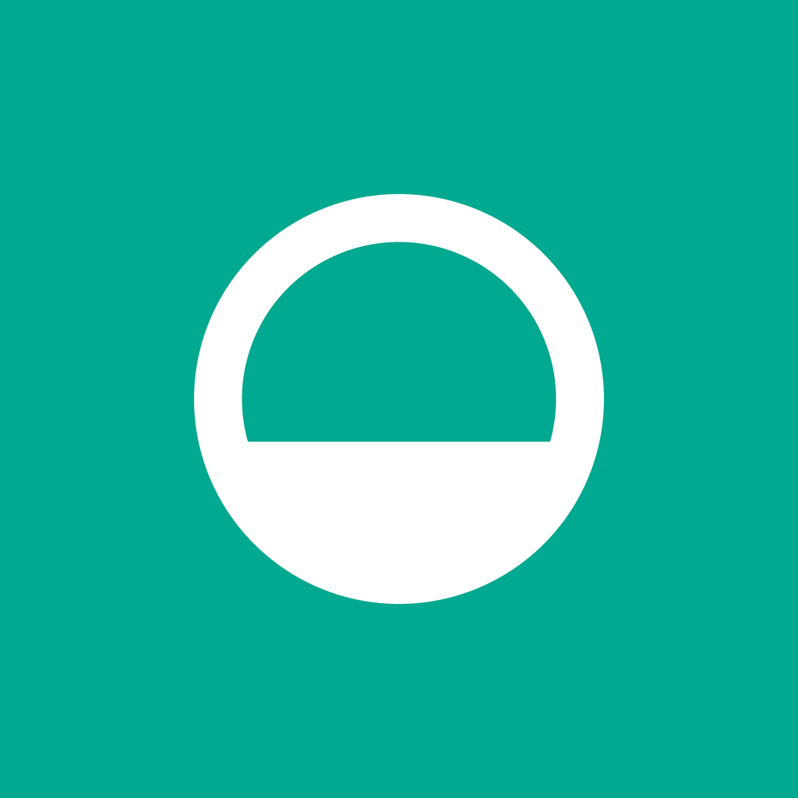

# Dewly

**Drink water. Keep the streak.** A calm, minimal iOS hydration reminder built with SwiftUI.



## Features

- **Today** – an Activity-style progress ring that springs forward as you log, one-tap `+150 / +250 / +500` pills, a custom amount sheet, and an Undo toast instead of confirmation dialogs.
- **Reminders** – local notifications between your wake and sleep times at your chosen interval. Log 250/500 ml or snooze 30 min straight from the notification.
  - *Smart timing* skips a reminder if you drank recently.
  - Reminders stop for the day once your goal is met.
  - An optional 8 PM *evening nudge* if your streak is at risk.
- **Streak** – current and best streak, this week, a month calendar of goal days, and milestones at 7 / 30 / 100 days.
- **History** – Swift Charts bars for week, month and year with a dashed goal line.
- **Onboarding** – pick a daily goal; notification permission is requested right after.

Design: SF Pro Rounded throughout (`.fontDesign(.rounded)`), capsule controls, inset-grouped cards, system colours with a single mint accent, full dark mode, haptics via `sensoryFeedback`, and springs for all motion.

## Requirements

- Xcode 16 or later
- iOS 18 or later (on iOS 26 the tab bar and toolbars pick up Liquid Glass automatically)

## Run

1. Open `Dewly.xcodeproj`.
2. Select the **Dewly** target → *Signing & Capabilities* → choose your team.
3. Run on a simulator or device.

To try notifications quickly, open **Reminders → Preview notification** and lock the device or leave the app within 3 seconds.

## Structure

```
Dewly/
├── DewlyApp.swift
├── Model/
│   ├── HydrationStore.swift      # @Observable store: entries, goal, streaks, settings (UserDefaults)
│   └── NotificationManager.swift # scheduling, actions, delegate
└── Views/
    ├── RootView.swift            # TabView + onboarding cover
    ├── TodayView.swift
    ├── AddWaterSheet.swift
    ├── StreakView.swift
    ├── HistoryView.swift
    ├── RemindersView.swift
    ├── OnboardingView.swift
    └── Components.swift          # ring, mark, pill buttons, cards, toast
design/
└── index.html                    # interactive design prototype
```

## Roadmap

- Interactive home-screen widgets and a Live Activity
- Apple Health water-intake sync
- Apple Watch companion
